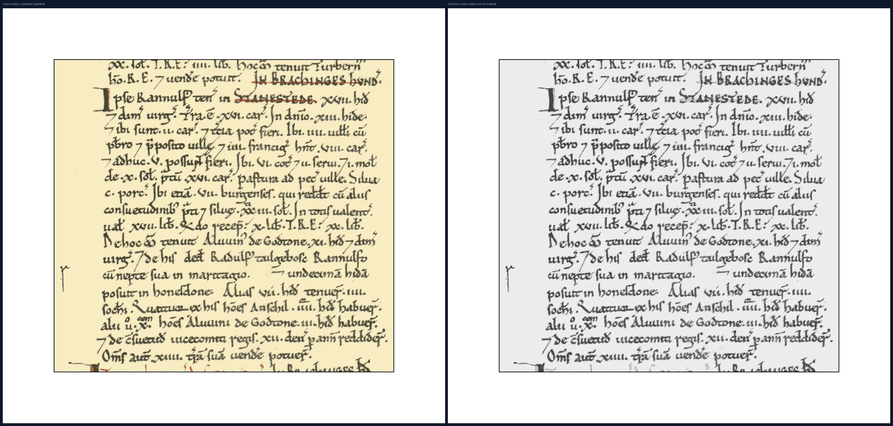
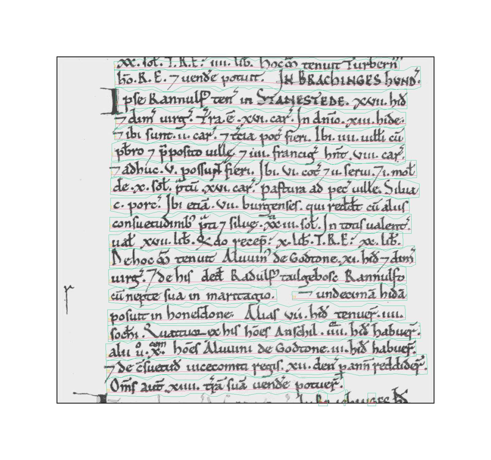
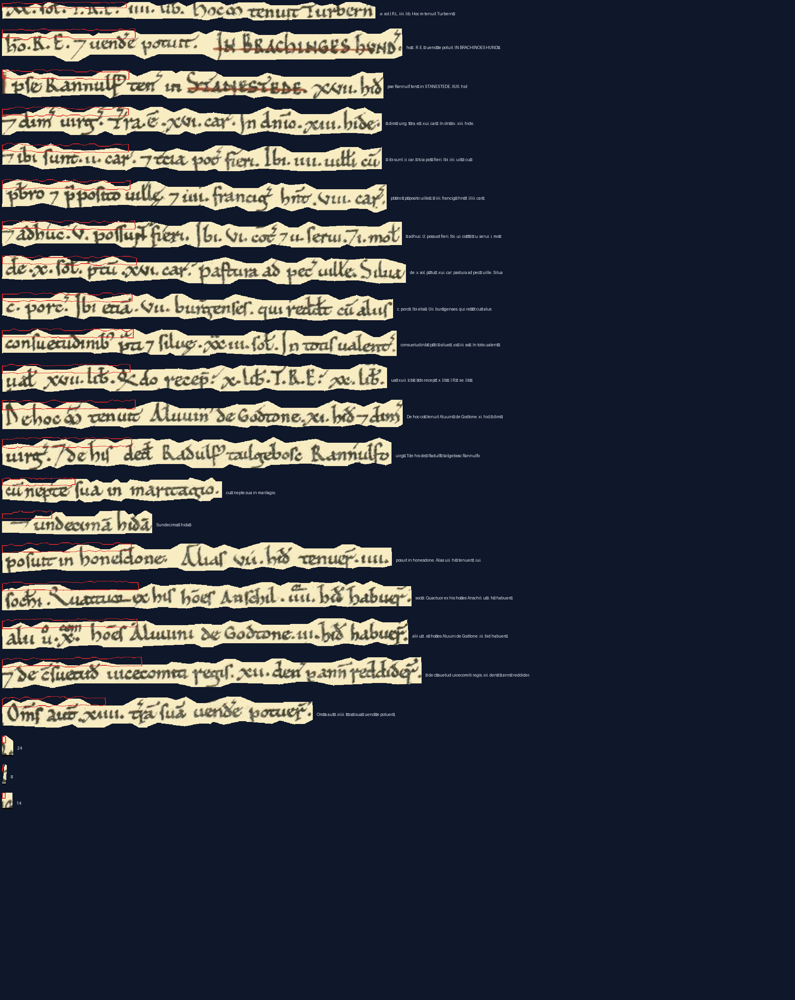
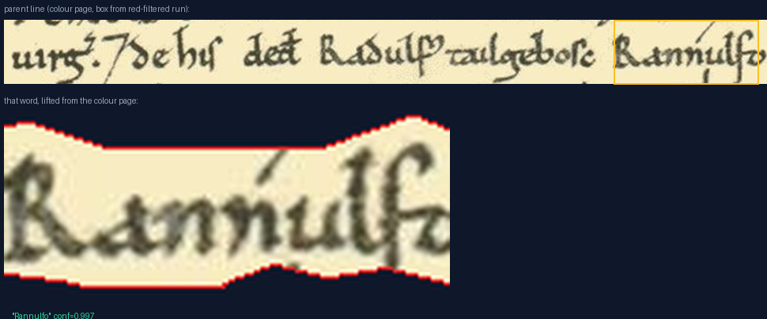

PIP Package WIP.

# PyCatmus

Handwritten-text recognition (HTR) for medieval manuscripts, powered by the
[CATMuS Medieval](https://zenodo.org/records/21488839) model and the
[Kraken](https://kraken.re) engine — packaged as a command-line tool and a
local web app with word-level hover-to-source highlighting.

Covers Latin, Old & Middle French, Iberian languages, Italian, Middle Dutch
and Occitan Gothic hands (12th–15th century book and cursive scripts).
Transcription is **graphematic**: abbreviations stay exactly as written
(`uileꝰ`, not `villes`), nothing is normalised, expanded or spell-corrected.

## Install

```bash
pip install PyCatmus
```

This gives you a CPU-only install (torch comes from PyPI). For GPU
(NVIDIA, CUDA 12.6):

```bash
pip install PyCatmus[gpu] --extra-index-url https://download.pytorch.org/whl/cu126
```

The two model files (~21 MB total) are **not** bundled. They are downloaded
automatically from Zenodo on first use into a local cache and verified
against their recorded md5. To fetch them up front (e.g. on an offline
machine):

```bash
pycatmus --download-models
```

Cache location: `%LOCALAPPDATA%\pycatmus\models` on Windows,
`~/.local/share/pycatmus/models` on Linux (`$PYCATMUS_MODELS` overrides).
`--model` / `--seg-model` point at any other `.mlmodel` file.

## Command line

```bash
# whole page → txt
pycatmus folio1r.png folio1r.txt

# single hand-cropped line (skips page segmentation — most accurate isolate)
pycatmus line4.png line4.txt --line

# remove red ink (rubrics/strikethroughs) before OCR, and write a
# per-word confidence overlay
pycatmus folio1r.png out.txt --red-filter --viz overlay.png

# every page matching a glob, models load once, .txt beside each image
pycatmus --batch "C:\scans\*.png"

# batch 4 ways in parallel (each worker loads the models once, ~2 GB VRAM)
pycatmus --batch "C:\scans\*.png" --jobs 4

# device: auto (default) | cpu | cuda:N
pycatmus page.png out.txt --device cuda:0
```

| Flag | Effect |
|---|---|
| `--line` | input is one text line; skip segmentation |
| `--red-filter` | erase red ink before OCR (see *Red ink* below) |
| `--viz FILE.png` | confidence overlay: word boxes green/amber/red, per-line mean scores |
| `--batch GLOB` | transcribe all matching images; one `.txt` per image |
| `--jobs N` | parallel workers with `--batch` |
| `--device auto\|cpu\|cuda:N` | compute target (default `auto`) |
| `--model` / `--seg-model` | override recognition / segmentation model files |
| `--keep-temp` | keep intermediate red-filter images |
| `--download-models` | fetch both models from Zenodo and exit |

Output is raw graphematic Unicode in NFD form (diacritics and superscripts
are separate codepoints — some editors display spacing oddly; it is not
corrupted). Tironian *et* comes out as `⁊`.

Model warm-up (loading into GPU) costs ~10–15 s per process; for repeated
work prefer `--batch` over one call per page.

## Web app

```bash
pycatmus-app            # http://127.0.0.1:5000
pycatmus-app --port 8080
```

- **Load** a local folder or image path, or upload images. Multiple pages
  stack scrollably in the left pane.
- **Generate** transcribes every loaded page in one run (progress in the
  header; a *Remove red ink* checkbox applies the red filter to the batch).
- **Hover any word** to see its exact bounding box drawn on the page image,
  plus a band over its source line. Low-confidence words carry an amber
  (<0.85) or red (<0.6) underline — check those against the image.
- **Edit** the transcription in place: click a line and type. Enter moves to
  the next line instead of splitting, because source lineation is content.
- **Export .txt** saves what you see (your edits included, line breaks kept);
  **Export original .txt** saves the untouched machine output.
- **Save HTML** exports a single self-contained file (page images embedded,
  edited transcription, hover-to-locate intact) that opens in any browser —
  no Python, no network. Read-only snapshot, not a live editor.

Runs locally; nothing leaves your machine.

## How it works

All four figures below come from one real run on a Domesday-Book folio
(Latin, Gothic cursive, red rubrics and strikethroughs).



**1. Red-ink filter.** Medieval red ink and yellowish parchment both live in
the image's RED channel: dark brown/black ink is dark in *every* channel, red
ink is dark only in green/blue, and parchment's yellowness is excess red. The
filter keeps the green channel as greyscale (ink stays black, parchment stays
white) and paints pixels where `red − green > 40` up to white. The right-hand
panel is literally what the models receive: rubrics and red strikethroughs
over *BRACHINGES HUND* and *STANESTEDE* are gone, so they can't garble the
black text they cross. The filter is lossy by design — a fully rubricated
line is erased too — so it is opt-in (`--red-filter`) for when red means
decoration or cancellation, not content.

**2. Line detection.** The BLLA segmenter runs on that filtered page and
returns true line geometry, not rectangles: a curved **boundary polygon**
hugging each line's ascenders and descenders, and a **baseline** following
its wavy rhythm. The recogniser crops each line *along the polygon* — which
is why tilted, ruled-less hands read well.



Purple outlines are text regions, green the per-line boundary polygons, rose
the baselines, each line numbered. (Run on the filtered page, so the red
rubrics that survive as ghosts here are outside any line and never
recognised.)

**3. Line extraction.** Every line is lifted out of the **original colour
scan** at the geometry found on the filtered page: the cut follows the
contour exactly — parchment appears only inside the shape, the navy canvas
shows through outside — with the red contour drawn over it and the
recognised text beside it. Because the boxes come from the red-free image
but the pixels come from the colour original, the crops show the real
parchment without the distractors that were removed before reading.



**4. Word extraction.** hOCR word boxes (also produced by the filtered run,
with per-word confidences) are transposed back onto the colour page the same
way. The word below — `Rannulfo`, conf 0.997 — is cut with its line's own
curved contour, clipped to the word's horizontal extent: top is the parent
line with the word boxed in amber, bottom is the word lifted from the
colour parchment.



Hovering any word in the web app draws exactly this box on the page image —
the same coordinates, computed the same way.

Figures are reproducible with
`python scripts/make_howitworks_figures.py <page.jpg> [word-substring]`.

## Red ink

Medieval red ink and yellowish parchment both live in the image's RED channel:

- dark brown/black ink is dark in **every** channel
- red ink is dark in green/blue but bright in red
- yellow parchment is bright in green (its yellowness is excess red)

So the filter keeps only the **green channel** as greyscale (ink stays black,
parchment stays white) and paints detected red-ink pixels — where
`red − green > 40` — up to parchment white. Strikethroughs and rubrics vanish
instead of confusing the recogniser; on the sample page this fixes a word
that reads `Srauesteds` (garbled by a red deletion) into `STANESTEDE`.

The filter is **lossy by design**: a fully rubricated line will be erased
too. Use `--red-filter` when red = decoration or correction; leave it off
when red carries content you want transcribed.

## Reading the overlay (`--viz`)

- **Word boxes**: green ≥ 0.85 mean confidence, amber 0.6–0.85, red < 0.6
- **Underlines**: detected text lines; blue = line found but nothing recognised
- **Numbers**: mean confidence for that line (`-` = empty)

## Getting good results

**What the models actually see.** The recogniser crops each text line and
resizes it internally, so page size does not matter — **line height in
pixels is the currency**. Rules that came out of real pages:

- Aim for **50–120 px line height** in the image you feed. Below ~35 px
  superscripts, macrons and Tironian `⁊` dissolve; above ~150 px nothing
  improves (the recogniser downsamples anyway) — you only burn GPU.
- A full folio of ~35 lines ≈ **2,500–4,000 px wide**; archival scans at
  300–400 DPI sit in the sweet spot. 600 DPI adds nothing.
- **Small images (phone photos, resized attachments) rescue well with
  ×2–3 Lanczos upscaling.** Harmless to the recogniser, and often decisive
  for the segmenter.
- **White padding fixes shattered segmentation.** A page whose text touches
  the image borders makes BLLA glue neighbouring rows together (observed:
  ~20 lines → 71 fragments). Adding a ~20–25 % white band around the image
  restored 13/13 correct lines on the same photo. Padding is not a crop —
  no pixels are lost.
- **Never crop mid-line.** Lines sliced by the photo edge transcribe badly
  and the missing part is unrecoverable; flag them instead.
- Whole pages beat paragraph crops: the segmenter uses layout context
  (baseline rhythm, margins) that a tight crop removes. If you must crop,
  crop generously with margin and add padding.
- **JPEG is fine** (doc-quality ≥ 85): artefacts only hurt when they eat
  thin marks — macrons, superscripts, hairline strokes. PNG is strictly
  better if you have it; never re-save a JPEG through several generations,
  and transcoding JPEG→PNG recovers nothing.

**Know the model's training domain.** CATMuS Medieval reads Gothic Latin/
French-era hands; it produces confident garbage on anything outside:
Anglo-Saxon square minuscule fails completely, 17th-c. court hand fails,
18th-c. copperplate shatters. For post-1500 English hands use McCATMuS
(`--model`, Zenodo 10.5281/zenodo.13788176); for anything else, treat the
raw output as a layout guide and verify per line with `--line`.

Also:

- Flat, well-contrasted scans, ideally ≥1500 px wide. Museum photos of
  angled books degrade badly.
- For a stubborn word, crop the line tightly and run with `--line`.
- Check the `--viz` overlay to find low-confidence words before reading.

## Injecting other models

PyCatmus is CATMuS Medieval by default, but **any Kraken `.mlmodel` can be
injected** — the recognition model is a plain file argument. (CATMuS Medieval
is one multilingual model — there is **no language flag** to set.)

```bash
pycatmus page.png out.txt --model path/to/other.mlmodel
pycatmus page.png out.txt --seg-model path/to/other-segmenter.mlmodel
pycatmus --batch "scans/*.jpg" --model path/to/other.mlmodel   # loaded once
```

Fetch models from the Kraken model repository with
`kraken list` / `kraken get <DOI>` (direct Zenodo URLs hit download blocks;
the Kraken CLI path works). Files land in the htrmopo cache — copy them next
to the others or pass the path explicitly; paths into the htrmopo cache
inside Kraken have crashed on Windows, absolute paths in `%LOCALAPPDATA%\pycatmus\models`
do not. Never fine-tune two different-domain models (e.g. CATMuS Medieval +
McCATMuS) into one checkpoint — pick the model by document date/script.

### Models we actually run

| Model | Source | Domain | Measured behaviour |
|---|---|---|---|
| **CATMuS Medieval 1.6** (default) | Zenodo 21488839 | 12th–15th c. Gothic Latin/French; book + cursive/administrative hands | Near-perfect on tidy Gothic cursive (Domesday-exchequer demo page); confident garbage on Anglo-Saxon minuscule, 17th-c. court hand; shatters on 18th-c. copperplate |
| **McCATMuS** | Zenodo 10.5281/zenodo.13788176 | 16th c.–present, incl. English | ≈85–90 % on clean post-1650 will/court hands (systematic `s→q`, `d→cl`, `u→oo` errors); dense secretary hands drop to ≈40–50 % with garbled lower lines — cross-validate against a second engine |
| **BLLA** (segmenter, `--seg-model`) | Zenodo 10.5281/zenodo.14602568 | general print + handwriting | Default page segmenter; weak below ~1000 px width (upscale ×2 first); can throw `TopologyException` on upscaled pages — fall back to native scale + padding |

Routing rule of thumb: medieval Gothic → default; post-1500 English →
McCATMuS; anything else → expect fragments, use `--line` on crops and
verify by eye. If you regularly work a script none of these reads, the
ketos fine-tune loop is the upgrade path (`ketos train -i`) — fine-tune
**one** base model on ~10 transcribed pages rather than hunting for a
unicorn checkpoint.

## Provenance and licences

| Component | Licence |
|---|---|
| PyCatmus code | MIT |
| CATMuS Medieval 1.6 model | [CC-BY-4.0](https://zenodo.org/records/21488839) |
| BLLA segmentation model | Apache-2.0 (Zenodo 10.5281/zenodo.14602568) |
| Kraken | Apache-2.0 |

If you publish transcriptions made with this tool, please credit the CATMuS
project (CREMMA, GalliCorpora, HTRomance, DEEDS; curator Thibault Clérice)
via the model DOI, and cite Kraken (Kiessling, *ICDAR 2025*,
doi:10.1007/978-3-032-04624-6_26). Transcription *output* itself carries no
licence from any of these — what you may publish depends on the terms
attached to the **source images**, not the software.

## Development

```bash
git clone <this repo> && cd pycatmus
uv venv .venv
uv pip install -e . "numpy<2.5" torch          # + --torch-backend=cu126 for GPU
```

Pitfalls:

- **numpy must stay `<2.5`** — Kraken 7.1.1's line-crop geometry calls
  `np.cross` on 2-D vectors; numpy 2.5 removed that support and text lines
  silently vanish (empty lines, no error). The pin is declared in
  `pyproject.toml`.
- On Windows consoles, child processes printing non-ASCII need
  `PYTHONUTF8=1`/`PYTHONIOENCODING=utf-8` (handled internally).
- Scipy prints a numpy-version `UserWarning` on every run; harmless noise.
- BLLA can raise `TopologyException: side location conflict` on some
  upscaled inputs (invalid predicted polygons). Observed on a 2–3× enlarged
  copperplate page; retry at native scale + white padding instead — do not
  treat it as corrupt input.
